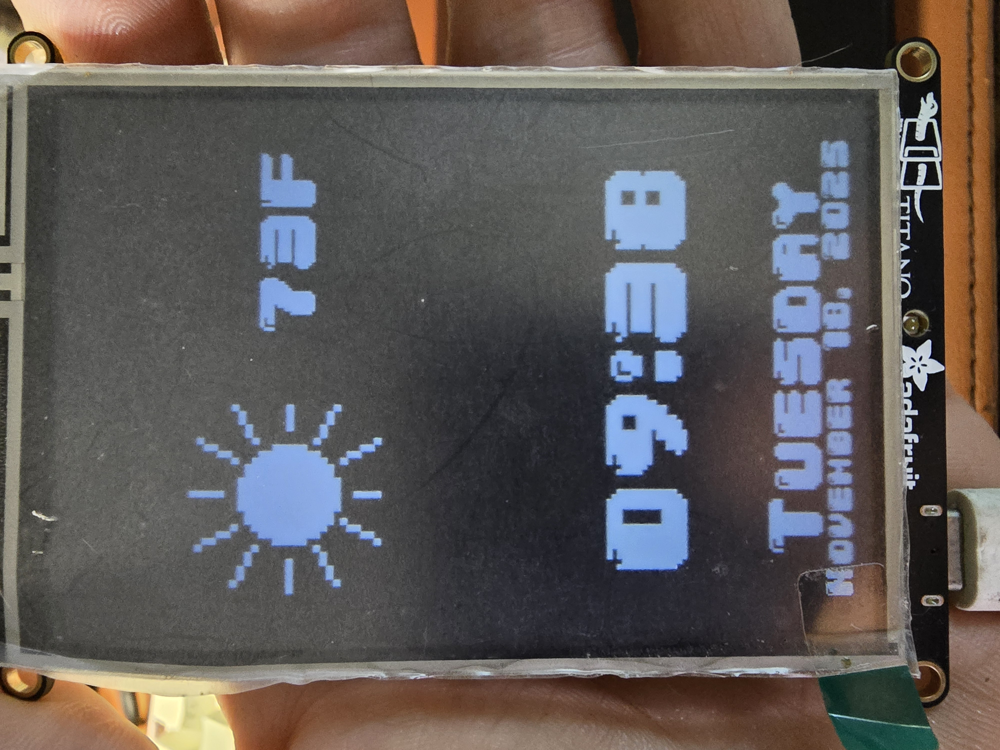

# PyPortal Titano Weather + Clock

A portrait-mode weather and clock display built using CircuitPython on the Adafruit PyPortal Titano.
This project demonstrates embedded firmware development, Wi-Fi API integration, display rendering, and real-world hardware interaction.

---

## Overview

## Why this project exists

This project started as a way to learn real embedded development on hardware that is not heavily documented. The PyPortal Titano has a larger portrait display and slightly different constraints than the more common PyPortal examples. Building this weather and clock display required combining CircuitPython, Wi-Fi APIs, UI layout work, and sensor handling into a single, working device.

It now serves as a reference for anyone who wants a concrete example of a small but complete firmware project: it talks to external services, renders a usable interface, and runs on real hardware on a desk, not just in a simulator.

This firmware turns the PyPortal Titano into a desk display showing:

| Component | Description |
|----------|------------|
| Time | Large digital clock with smooth refresh |
| Date | Full weekday and MM/DD format |
| Weather | Temp and icon from Open-Meteo API |
| Brightness | Automatic dimming via onboard light sensor |
| Internet connectivity | Periodic refresh and graceful offline fallback |
| Portrait UI | Optimized for 480×320 resolution |

---

## Example



---

## Hardware

| Component | Description |
|-----------|-------------|
| Adafruit PyPortal Titano | 480×320 touchscreen microcontroller |
| ESP32 AirLift | Wi-Fi coprocessor for API requests; see the transport limits below |
| Light sensor | Controls automatic screen brightness |
| Weather BMP sprites | 32×32px icons |
| 04b30-20.bdf | Pixel font used for display text |

---

## Repository Structure

```
pyportal-titano-weather-clock/
├── code.py
├── .gitignore
├── README.md
├── EXAMPLE_settings.toml
├── LICENSE
├── pyportal_titano_weather_clock_example.jpg
├── fonts/
│   └── 04b30-20.bdf
├── weather_icons_32x32_9.bmp
└── Changelog
```

---

## Setup
The steps below assume that CircuitPython is already installed on the PyPortal Titano and that the board appears as the CIRCUITPY drive on your computer.

### 1. Install CircuitPython and libraries
The current `code.py` targets CircuitPython 10.x. Install CircuitPython for the PyPortal Titano:
https://circuitpython.org/board/pyportal_titano/

Install the matching [Adafruit CircuitPython library bundle](https://circuitpython.org/libraries) dependencies under `CIRCUITPY/lib/`, including `adafruit_display_text`, `adafruit_esp32spi`, and `adafruit_requests`. The font and image features also use `adafruit_bitmap_font` and `adafruit_imageload` when available.

### 2. Copy the project files to CIRCUITPY
Place the following on the board:

```text
code.py
weather_icons_32x32_9.bmp
fonts/04b30-20.bdf
```

### 3. Create settings.toml

Copy `EXAMPLE_settings.toml` to `settings.toml` at the root of `CIRCUITPY`, then replace both placeholders:

```toml
CIRCUITPY_WIFI_SSID = "YOUR_WIFI_NAME"
CIRCUITPY_WIFI_PASSWORD = "YOUR_WIFI_PASSWORD"
```

The firmware reads these exact keys with `os.getenv()`. It does not import `secrets.py`; the old Python dictionary examples have been removed. Keep your filled-in `settings.toml` local. It is ignored by Git and separates credentials from code, but does not encrypt them. See [CircuitPython environment variables](https://docs.circuitpython.org/en/stable/docs/environment.html).

### 4. Set the weather location and time fallback

Edit `LATITUDE` and `LONGITUDE` in `code.py` for the weather location; the checked-in coordinates are a generic example. Time is requested from WorldTimeAPI's IP-based endpoint, with `America/New_York` as the fallback in `TIMEZONE_API_FALLBACK`. Change that URL's IANA timezone when needed. The former `timezone` entry in `secrets.py` was not read by this firmware.

`UTC_OFFSET = None` uses the API's raw and daylight-saving offsets. A numeric override is a fixed offset in hours and will not adjust itself for daylight saving. Reset the board after changing configuration.

---

## Timezone Format (IANA Standard)

Examples:

America/New_York
America/Chicago
Europe/London
Asia/Tokyo
Australia/Sydney

Use the desired IANA identifier in `TIMEZONE_API_FALLBACK`, for example `http://worldtimeapi.org/api/timezone/America/Chicago`.

## Network transport and verification limits

The current firmware's weather and time URLs use **HTTP**, so those API responses are not protected by TLS. Creating an SSL context in `code.py` does not turn an `http://` URL into HTTPS. No secure-transport claim is made for this revision.

[Open-Meteo's documentation](https://open-meteo.com/en/docs) provides an HTTPS forecast API. A credential-free desktop request to the configured forecast endpoint over HTTPS returned HTTP 200 during the 2026-11-01 review. HTTPS probes to both WorldTimeAPI URLs failed TLS negotiation from the review environment, so their HTTPS operation was not confirmed. The existing firmware URLs have been retained pending an end-to-end board check rather than inferring AirLift compatibility from a desktop response.

Before changing the firmware to HTTPS, verify time and weather refresh, certificate handling, and reconnect behavior on the actual Titano/AirLift with the installed CircuitPython and library versions. No hardware run was performed for this documentation correction.

---


## Skills demonstrated

- CircuitPython firmware development on microcontroller hardware  
- Integration with external REST APIs for time and weather data  
- Display layout and rendering for a constrained portrait screen  
- Light sensor-based control and hardware abstraction  
- Debugging of network, timing, and rendering issues on a physical device  
- Credential configuration separated from source with ignored `settings.toml`
- Use of Git, GitHub topics, releases, and project structure for a small embedded project


---

## Roadmap

| Feature | Status |
|---------|--------|
| Touch settings menu | Planned |
| Offline visual indicator | Planned |
| Minimal UI mode | Planned |
| Theme variations | Planned |

---

## Contributing
Pull requests and issues are welcome.

---

## License
MIT License

---

## Acknowledgements
Adafruit Industries for hardware reference docs and CircuitPython examples.

---

## Project metadata

- License: see the `LICENSE` file in the repository root (MIT)  
- Change history: see [Changelog](Changelog). Check the repository's tags and releases for published artifacts; documentation updates do not imply a new hardware-qualified release.
